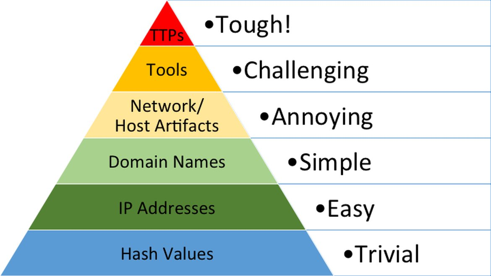

# Actores de amenaza

Un **actor de amenaza** es una entidad o grupo que representa una amenaza para una o más instituciones. De acá se desprende que lo es un actor de amenaza para algunos no necesariamente lo es para otros.

> [!COMMENT]
> A pesar de lo anterior, existen listas de agrupaciones cuyo objetivo es generar daño general a empresas y sistemas, generalmente por motivaciones políticas o de dinero. En la práctica, cuando algo se define como "actor o grupo de amenaza", se considera que está orientado a atacar sistemas de países occidentales, en algunos casos de forma dirigida (como en las guerras en entorno digital) y en otros por motivos oportunistas (vulnerabilidad existente y posibilidad de extorsión o acceso a recursos valiosos).

Cuando un actor de amenaza tiene mucha experiencia, está muy bien financiado o lo respalda un país, suele ser conocido también como una **Amenaza Persistente Avanzada** o _APT_ en inglés.

## Clasificadores de actores de amenaza

No existe un clasificador universal. Cada país (o empresa de ciberseguridad) mantiene sus propias clasificaciones, con nomenclaturas que representan región y capacidades. 

Las empresas estadounidenses usan nomenclatura muy basada en países de origen, al menos para todos los actores de amenaza que no se ponen nombre propio y que requieren seguimiento.

* **Microsoft** usa [esta nomenclatura](https://learn.microsoft.com/en-us/defender-xdr/microsoft-threat-actor-naming) y asigna un ícono por atacante.
* **Mandiant/Google Cloud** usa [esta nomenclatura](https://cloud.google.com/blog/topics/threat-intelligence/updated-cyber-threat-actor-naming-system) actualizada hace poco. Antes, se usaban prefijos y números.
* **MITRE ATT&CK** también tiene su propia [taxonomía](https://attack.mitre.org/groups/).

En otros casos (especialmente hacktivistas, malware como servicio o grupos de ransomware), los nombres se los ponen los mismos grupos de amenaza.

## Fases de un ataque

Hay dos modelos estandarizados que definen las fases de un ataque:

* **[Cyber Kill Chain](https://www.lockheedmartin.com/en-us/capabilities/cyber/cyber-kill-chain.html)**: Creado por la empresa militar estadounidense Lockheed Martin. Define las etapas de ataque tradicionales de un APT:
    * **Reconocimiento**: Atacante obtiene recursos que le facilitarán el ataque, como exploración del hardware de la víctima o correos electrónicos de trabajadores.
    * **_Armificación (?)_**: Combinar un _exploit_, un _backdoor_ en un _payload_ entregable a la víctima.
    * **Entrega**: Hacer llegar lo anterior a la víctima por internet, USB, etc.
    * **Explotación**: Explotar una vulnerabilidad para llegar a tener control del sistema de la víctima.
    * **Instalación**: Despliegue de malware en el recurso
    * **Comando y Control** (C2): canal remoto para manipulación de la víctima.
    * **Acciones en el objetivo**: Con todo lo anterior preparado, los atacantes pueden cumplir su objetivo original (ransomware, espionaje, robo de información, etc).
* **Tácticas en _MITRE ATT&CK_**: La corporación MITRE define, en su framework ATT&CK, un conjunto de _tácticas_ que son objetivos específicos deseados por el actor de amenaza. Se pueden encontrar estos objetivos en [este enlace](https://attack.mitre.org/tactics/enterprise/).
* **Sitios como [ransomware.live](https://ransomware.live/)**: llevan registro de los nombres de actores de amenaza autodefinidos.

## Algunos tipos de actores de amenaza

* **Malware como servicio**: Se entiende como _malware como servicio_ al desarrollado y vendido a medida por grupos de amenaza a otros grupos de amenaza. Uno de los ejemplos más comunes es el _Ransomware como Servicio_, donde un proveedor de ransomware entrega la plataforma completa a un atacante para ejecutar su ataque: desde los accesos iniciales en algunos casos hasta el malware específico que debe ejecutar para generar el efecto deseado.
* **Initial Access Brokers**: Grupos o actores de amenaza que se encargan solamente de robar credenciales para su uso en técnicas de acceso inicial. Muchos de ellos usan phishing o infostealers para esto.
* **Carding**: Robo y venta de tarjetas de crédito robadas, ya sea a través de exfiltración de datos de instituciones, robo desde navegadores o el envío de sitios web fraudulentos a clientes.
* **Venta de servicios ilegales**: Algunos actores de amenaza se financian vendiendo servicios ilegales, como _hackeo_ a cuentas de otras personas, vulneración de instituciones por dinero, venta de licencias médicas u obtención de certificados fraudulentos.

## Perfilando a un actor de amenaza

Para saber cómo protegerse ante un actor de amenaza específico, es necesario perfilarlo, recabando la mayor cantidad de información sobre su comportamiento. Veremos a continuación algunas formas comunes de perfilamiento.

### Por sus indicadores de compromiso: la pirámide del dolor

Los **Indicadores de Compromiso** o _IoC_ por sus siglas en inglés son artefactos técnicos que suelen ser repetidamente usados por un atacante al actuar, por lo que observarlos continuamente nos puede alertar de un intento de ataque o ataque en curso. 

Entre ellos, se encuentran hashes, direcciones IP y de dominio, artefactos de red o de host, herramientas particulares y por último TTPs (de esto más adelante). 

Sin embargo, hay _IoCs_ que cambian muy seguido porque no es costoso para el atacatne realizar este cambio. Sobre este punto, el profesional de ciberseguridad David J. Blanco en 2013 describió los indicadores de compromiso más conocidos sobre una jerarquía piramidal asociada al "dolor" que siente una atacante si el IoC logra ser bloqueado: los que están más abajo son mucho más fáciles de cambiar (para cambiar el hash de un archivo basta con cambiarle un solo byte). Los que están más arriba cuesta cambiarlos, porque el grupo o actor de amenaza ya está acostumbrado a actuar de una forma, y los IoC más criticos están más asociados a ese tipo de comportamientos.

## ¿Qué son las Tácticas, técnicas y procedimientos?

Hablemos de los TTP de MITRE ATT&CK, que ya hemos mencionado dos veces antes de definirlos.

Los TTP son comportamientos generalizados llevados por los atacantes para ejecutar sus ataques. Como definimos anteriormente, la táctica es el objetivo que se logra obtener. La técnica por su lado es el método a grandes rasgos que se planea ejecutar. El procedimiento es una descripción más detallada de cómo se llevó a cabo la técnica específica.

Si quieres ver la lista completa de TTPs, puedes hacerlo en el [Mitre ATT&CK navigator](https://mitre-attack.github.io/attack-navigator/).

## ¿Mitigaciones?

No existe una mitigación universal para un grupo de amenaza, pero sí existen medidas que pueden ayudar a no ser la próxima víctima de uno de ellos:

* Basado en los TTPs, tomar las medidas defensivas o controles de ciberseguridad que evitan la explotación de debilidades o vulnerabilidades en las que los atacantes son expertos.
* Basado en los IoC, establecer bloqueos automáticos de los detectados, siempre validando primero su autenticidad.
* Aplicar las medidas de seguridad estándares y mencionadas en la unidad de desarrollo seguro.

 > [!COMMENT]
 > Hay personas que dicen que esto es cada vez menos efectivo, debido a que la IA generativa ha bajado tanto la vara en algunos casos, que no es necesario que los atacantes sepan cosas para atacar. De todos modos, combinando las buenas prácticas vistas en desarrollo seguro con los consejos de esta sección, los atacantes muy probablemente encontrarán más fácil ir a atacar a alguien que no ha tomado todas estas medidas. 
