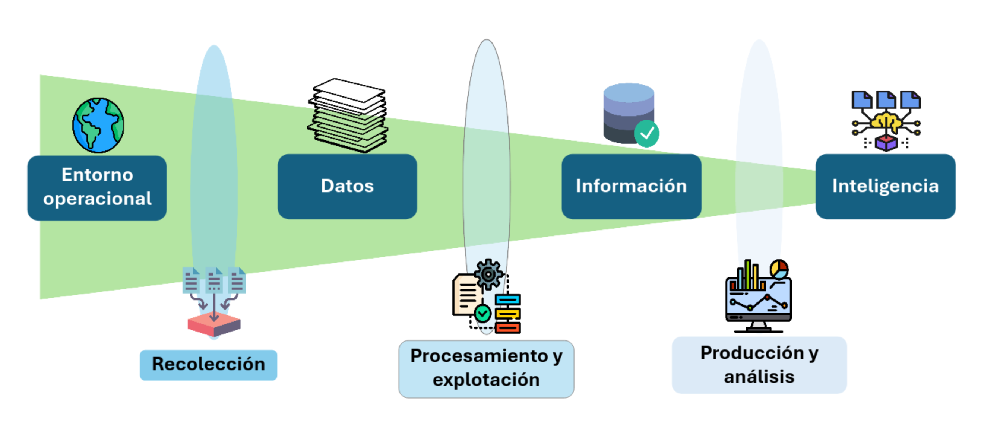
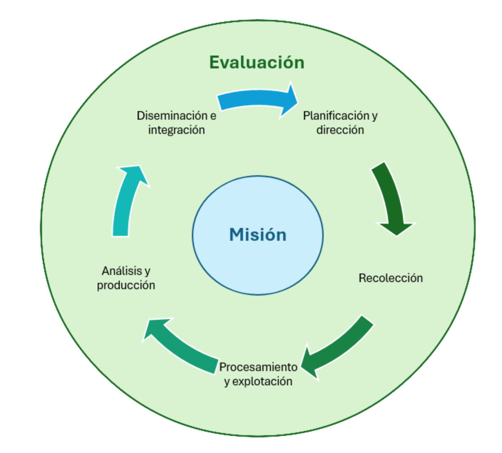

Para prevenir de forma eficiente un incidente de ciberseguridad, conviene conocer los patrones de ataque de los atacantes, sus objetivos y las herramientas que usan para lograrlos. Al mismo tiempo, conviene saber qué tecnologías usan las potenciales víctimas y si estas son vulnerables a algún tipo de ataque conocido. De esta forma, podemos enfocar nuestros esfuerzos en proteger lo más crítico con medidas acotadas pero efectivas.

Lo anterior no es posible si no se cuenta con datos de buena calidad, los cuales deben ser estructurados, analizados y discutidos por expertos y expertas en los sectores apoyados por tecnologías de la información que son vulnerables. 

En esta sección, hablaremos del proceso completo de inteligencia de amenazas, que contempla desde la recolección de datos hasta la diseminación de inteligencia a los organismos que puedan actuar sobre ella, previniendo incidentes de esta forma.

# Inteligencia de Amenazas

La _inteligencia_ corresponde a la recopilación de datos e información para ser posteriormente evaluados, analizados e interpretados, con el objetivo de generar conocimiento sobre intenciones y actividades de otras entidades (generalmente adversarias) y apoyar la toma de decisiones a partir de esto.

Específicamente, la _inteligencia de amenazas_ es el perfilamiento de los actores de amenaza (ya mencionados en esta sección) y sus potenciales víctimas, entregando mayor visibilidad de los patrones de ataque conocidos para generar recomendaciones que eviten su ejecución exitosa. Esto requiere:

* **Conocimiento del dominio**: Qué tipo de software o hardware se usa, cómo suele configurarse, quién suele operarlo, si suele o no estar expuesto, si hay instituciones que regulen o fiscalicen que se sigan las buenas prácticas, en caso de existir.
* **Conocimiento de los atacantes**: Qué buscan, cuánto conocimiento poseen, qué herramientas prefieren usar, cuáles suelen ser sus víctimas, en qué horarios operan, cómo consiguen el acceso inicial, qué tipo de impacto buscan generar.
* **Conocimiento de las debilidades existentes**: Vulnerabilidades o debilidades conocidas, aplicaciones expuestas, ataques en otros países o sectores económicos.
* **Conocimiento de las técnicas de ataque aplicadas**: El desarrollo y la utilización de herramientas de ataque de acceso general, patrones de detección al momento de elegir qué atacar. 

Para conocer todo lo anterior, se requiere contar con varios ejemplos de ataques y de comportamiento de los actores de amenaza. Esta información 

## Conceptos de inteligencia

Antes e hablar de las etapas de los procesos de inteligencia de amenazas, definiremos algunos conceptos relacionados con lo recolectado y lo producido en estos procesos.

### Datos, información e inteligencia

* **Entorno operacional**: El universo del cual se recolecta información. En el caso de la inteligencia sobre amenazas cibernéticas, se refiere a servicios (páginas web, bases de datos, otras aplicaciones expuestas) disponibles en Internet.
* **Datos**: Conocimiento no estructurado, validado ni analizado.
* **Información**: Conocimiento estructurado, de mejor calidad que los datos, sobre el cual se puede operar.
* **Inteligencia**: Proyecciones, suposiciones, teorías o patrones generados a partir de la información recopilada.

> [!TIP]
> Un ejemplo: Eres CISO de un holding de empresas internacional y recibes un reporte de un encargado de ciberseguridad local que encuentra tráfico sospechoso de entrada en su infraestructura (algo que parece un escaneo).
> Al analizar el escaneo, notas que el escaneo recorre las IPs de tu institución de forma creciente y no aleatoria. Sospechas que muy pronto este escaneo será notado por la encargada de ciberseguridad de otro país (las IP  del holding completo están en el mismo segmento). También notas que está intentando explotar una vulnerabilidad conocida, gracias a que tienes la posibilidad de comparar el payload con una fuente de datos cerrada de un proveedor.
> Afortunadamente, hasta donde entiendes, tu institución no usa versiones vulnerables de ese software, pero de todas formas y para prevenir, decides generar una alerta interna para revisar tráfico malicioso y ordenar el parchado de cualquier aplicación vulnerable, interna o externa.

### Proceso de inteligencia

En la imagen anterior se ven las partes del proceso continuo de inteligencia. Algunas (como misión y evaluación) son continuas y marcan la dirección de las otras etapas. Las otras son cíclicas y 

* **Misión**: El objetivo de la organización y del equipo de inteligencia de amenazas. Es distinto si es un equipo de una empresa privada que provee este tipo de servicios externamente, de una empresa privada que los provee de forma interna, de un organismo público nacional o de un organismo internacional.
* **Recolección**: Etapa en la que se explora el entorno operacional y se recopilan datos.
* **Procesamiento y explotación**: Recibe los datos recopilados y los estructura y analiza preliminarmente, generando información.
* **Producción y análisis**: Recopilación, cruce y análisis de información para producir inteligencia.
* **Diseminación e integración**: Generación de productos (reportes, alertas, recomendaciones, normativa) que tengan un efecto directo en la prevención de incidentes según el conocimiento generado.
* **Evaluación**: El proceso continuo que determina si la calidad de los productos es la adecuada, según su impacto y efecto en la prevención de incidentes, realizando cambios en parte de los procesos para mejorarla, de ser necesario.

## Herramientas y fuentes comunes

A continuación enumeramos algunas herramientas y fuentes de inteligencia de amenazas útiles

### Escaneos pasivos

* **[Shodan](https://www.shodan.io/explore)**: Escáner semi-abierto (se puede usar limitadamente sin pagar) que indiza IPs y puertos expuestos en el mundo para encontrar dispositivos con software específico. 
* **[Zoomeye](https://www.zoomeye.ai/)**: Lo mismo que Shodan, pero el proveedor es una empresa china.
* **[Censys](https://search.censys.io/)**: Otra plataforma para encontrar dispositivos expuestos a Internet y dimensionar el impacto de vulnerabilidades. 

### Datos de actores de amenaza
* **[Ransomware.live](https://ransomware.live/)**: Plataforma abierta que realiza seguimiento de los sitios de filtración de datos (DLS) de actores de amenaza que usan ransomware dentro de sus técnicas de impacto.
* **[MITRE ATT&CK](https://attack.mitre.org/)**: Dentro del esquema ATT&CK, también están definidos ciertos actores de amenaza conocidos, con un código específico y asociados a ciertas TTPs.
* **Fuentes de empresas privadas**: Las empresas privadas (como [Google](https://cloud.google.com/security/products/threat-intelligence) y [Microsoft](https://www.microsoft.com/en-us/security/blog/topic/threat-intelligence/)) desarrollan sus propios procesos internos de inteligencia de amenazas y publican parte de la información en sus procesos de diseminación.

### Fuentes de malware e indicadores de compromiso
* **[URLScan.io](https://urlscan.io/)**: Sitio web que permite a analistas de ciberseguridad revisar URLs en busca de malware o comportamientos fraudulentos.
* **[VirusTotal](https://www.virustotal.com/gui/home/upload)**: Sitio web (de una empresa subsidiaria de Google) que permite subir malware o IoCs como hashes y URLs para escanearlas usando múltiples herramientas simultáneamente.
* **[Any.run](https://app.any.run/)**: Sitio web que permite correr máquinas virtuales para determinar el comportamiento de malware a partir de su ejecución en sandboxes, registrando cambios en sistema y comunicaciones a servidores externos.
* **[Joe Sandbox](https://www.joesandbox.com/)**: Mismo objetivo que Any.run, pero por otro proveedor

### Fuentes primarias
* **Data Leak Sites**: Sitios en la Dark Web (TOR generalmente) mantenidos por los actores de amenaza para publicar la información de las víctimas que no pagan (o para amenazara a las víctimas que todavía pueden pagar a hacerlo, mostrando su nombre como afectadas).
* **Foros de ciberdelincuentes**: Sitios web en clear web y dark web que permiten a ciberdelincuentes registrarse y comprar, vender o regalar accesos e información. Los equipos de inteligencia de amenazas los monitorean para reaccionar a tiempo en caso de exfiltración de información. 

### Fuentes cerradas

Algunas de estas fuentes están disponibles solo para equipos nacionales de ciberseguridad. A continuación mencionamos las que posee en Chile la ANCI, según charlas públicas.

* **Reportes de incidentes de ciberseguridad**: La Ley Marco de Ciberseguridad (se discutirá en una futura unidad) obliga a los Prestadores de Servicios Esenciales a reportar los incidentes de ciberseguridad de efecto significativo que los afectan. Esto supone una fuente de datos de ataques muy valiosa para analizar patrones de ataque y generar recomendaciones que eviten que estos sean exitosos. Las instituciones están obligadas a reportar a través del [Portal ANCI](https://portal.anci.gob.cl/iniciar-sesion/?next=/inv).
* **Reportes ciudadanos**: Desde mediados de 2026, la Agencia Nacional de Ciberseguridad recibe oficialmente datos de ciudadanos relacionados con patrones de atacantes y vulnerabilidades potencialmente explotables. Esta información ayuda a determinar la robustez o fragilidad de ciertos sectores económicos según los hallazgos de ciudadanos y de la misma Agencia. Esta información está disponible en el [Registro de Ciberinvestigadores](investigadores.anci.gob.cl).
* **Feeds internacionales**: Hay instituciones internacionales que entregan acceso a fuentes de inteligencia solo a CSIRTs nacionales o administradores de redes que puedan demostrar su dominio de trabajo, como por ejemplo la Red [CSIRTAmericas](https://csirtamericas.org/es), [ShadowServer](https://www.shadowserver.org/) o [Team Cymru](https://www.team-cymru.com/).
* **[IntelligenceX](https://intelx.io/)**: Plataforma pagada que monitorea leaks de canales usados por atacantes (Telegram, Dark Web, Pastebin, etc), dando acceso solo a sus usuarios pagados. En esta fuente se suelen encontrar credenciales filtradas de usuarios afectados por infostealers.
