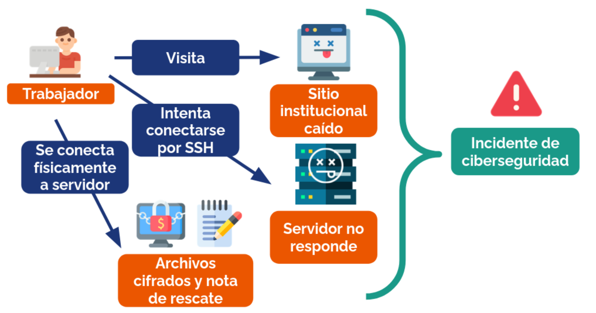
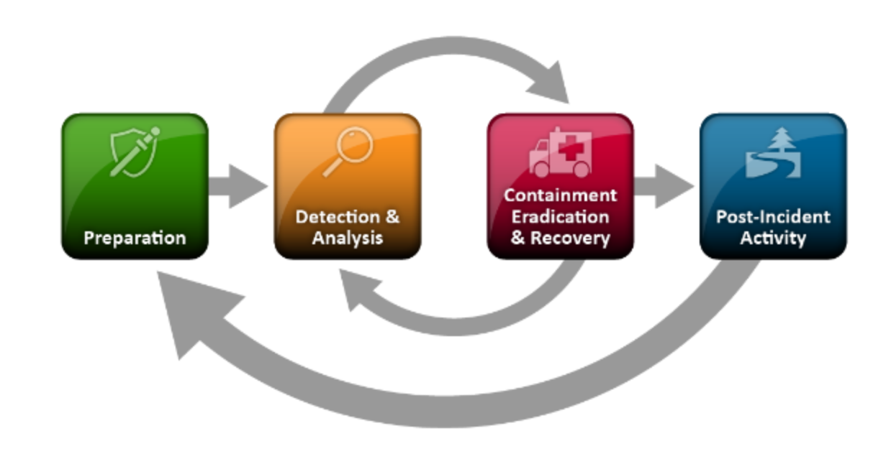
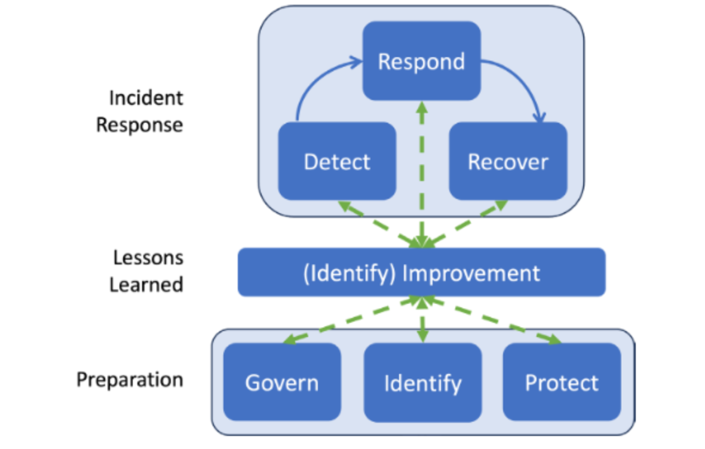

# Respuesta a Incidentes

Por mucho que evitemos (o no evitemos) ser afectados por las acciones de un actor de amenaza, posiblemente éste logrará su objetivo en alguna ocasión.

Una observación común en ciberseguridad es que quien defiende tiene que salirse con la suya siempre para ganar, pero quien ataca basta con lograrlo solo una vez. Suena bastante injusto, ¿no?

Por eso, es importante que, cuando nos veamos enfrentados a una situación de este estilo, tengamos un plan. En esta sección del curso hablaremos de los planes más comunes y cómo funciona cada etapa de ellos. También les contaremos cómo funcionan los reportes obligatorios de incidentes en Chile, los cuales aplican desde marzo de 2025 a los "servicios esenciales" según la [Ley Marco de Ciberseguridad](https://www.bcn.cl/leychile/navegar?i=1202434).

## ¿Qué es un incidente de ciberseguridad?

Sin meternos a fondo en la Ley Marco de Ciberseguridad (la veremos con más calma en la unidad de normativa), según ella un incidente de ciberseguridad es un evento que afecta la confidencialidad o integridad de la información, la disponibilidad o resiliencia de redes y sistemas informáticos, o la autenticación de procesos ejecutados o implementados en redes y sistemas informáticos.

En la práctica, lo que suele ocurrir es algo como lo de la siguiente imagen:

* Trabajador llega temprano a la oficina e intenta conectarse a una plataforma institucional. La plataforma no contesta.
* Esta persona pregunta al área de Tecnologías de la Información ("Equipo TI") por el problema. Alguien del equipo intenta conectarse remotamente a los sistemas, pero el intento de conexión no resulta. 
* Finalmente, alguien decide ir directamente al _datacenter_ de la organización. Allá encuentran que los equipos están encendidos, pero desconectados. Al ingresar conectando un terminal directo al servidor, esa persona encuentra todos sus archivos cifrados y una "nota de rescate" en formato texto en su carpeta _home_.

El caso anterior es un caso típico de ransomware. Probablemente, la institución perdió la información (por lo menos) de las últimas horas en sus sistemas. Cuánto perdió va a depender de si llevaban respaldos periódicos y si el atacante logró o no tener acceso a esos respaldos (para cifrarlos).

Hay otros tipos de incidentes también, como explotación de vulnerabilidades, phishing, denegaciones de servicio, entre otros. La taxonomía que usamos en Chile está definida en [el sitio web de la ANCI](https://anci.gob.cl/noticias/deber-de-reportar-taxonomia/).

En fin, volvamos al incidente. ¿Qué hacemos ahora?

## Equipos de respuesta a incidentes (CSIRTs)

> [!COMMENT]
> Se pronuncia _cesir_.

En instituciones, sectores económicos y países, hoy se arman equipos enfocados específicamente en responder incidentes de ciberseguridad. A estos equipos se les conoce como CSIRT o _Computer Security Incident Response Teams_.

> [!COMMENT]
> ¿Sabías que el laboratorio de criptografía aplicada y ciberseguridad de la Facultad (CLCERT) partió como un equipo de respuesta a incidentes? 
>
> De hecho, CERT significa algo parecido a CSIRT: _Computer Emergency Response Team_. El nombre CERT no fue libremente usable un tiempo porque es una [marca registrada](https://www.sei.cmu.edu/cybersecurity-center-development/authorized-users-of-the-cert-mark/) de uno de los primeros CERT/CSIRT en existencia: el de el _Software Engineering Institute_ de _Carnegie Mellon University_. Actualmente, en países distintos a EE.UU., la CMU no se opone al registro de la marca CERT, y se usa CERT y CSIRT en todos lados como términos intercambiables.

El 2016, la Organización de Estados Americanos publicó [este](https://www.oas.org/es/sms/cicte/ciberseguridad/publicaciones/2016%20-%20Buenas%20Practicas%20CSIRT.pdf) manual para orientar a países de la región a armar sus propios "CSIRT Nacionales". En este manual, podemos encontrar varias definiciones de lo que hace un CSIRT:

* **Tiene un ámbito**: Puede servir a todo un país (CSIRT Nacional desde 2025), a solo el gobierno (CSIRT de Gobierno hasta 2024), solo al sector militar (CSIRT de la Defensa Nacional), a solo universidades (CSIRT Reuna) a solo empresas generadoras de electricidad (Proyecto de CSIRT Eléctrico), a bancos (CSIRT de la Asociación de Bancos), a una comuna (Ciberseguridad Peñalolén) o a una empresa (y a sus clientes) en específico (CSIRT de Entel, Sonda, Falabella, etc).
* **Ofrece servicios**: El primero es apoyar en la respuesta a incidentes de ciberseguridad a sus "clientes" o "constituyentes". Además de ese, suelen agregarse otros tipos de servicios orientados a prevenir incidentes (mientras más incidentes se prevengan, menos incidentes hay que responder). Algunos servicios adicionales suelen ser:
    * **CNA** para recibir reportes de vulnerabilidades locales (ver capítulo de CVEs)
    * **Pentesting** para aplicaciones de sus constituyentes.
    * **RFT** (_Request for Takedown_), para bajar sitios fraudulentos.
    * **Publicación de alertas e IOCs**, a partir de información de incidentes anteriores o en curso.
    * **Análisis de Malware**, a partir de muestras tomadas en incidentes y correos sospechosos.
  Casi todos los servicios recién mencionados los ofrece el [CSIRT Nacional](https://csirt.gob.cl/servicios)
* **Se relaciona con socios** del sector público y privado con los cuales colabora para prevenir y gestionar eficazmente incidentes de ciberseguridad. Un ejemplo son las relaciones con ISPs y empresas de ciberseguridad, las policías u otras instituciones.
* **Tiene un marco legal específico**: En Chile, ese marco es la Ley Marco de Ciberseguridad, que le da al CSIRT amplias facultades y un grupo de constituyentes enorme.

> [!COMMENT]
> (Al menos en Chile,) un CSIRT no es una policía digital. Su objetivo es prevenir y responder a incidentes. El perfilamiento de actores de amenaza sirve para detectar puntos débiles en sistemas informáticos nacionales y recomendar medidas que eviten que las debilidades sigan siendo explotadas. 

## Etapas para responder a un incidente de ciberseguridad

Nos enfocaremos en un modelo específico de respuesta a incidentes: [NIST SP 800-61r3](https://nvlpubs.nist.gov/nistpubs/specialpublications/nist.sp.800-61r3.pdf). Este modelo es una actualización de uno anterior (SP 800-61r2), el que se ve en esta imagen: 

El modelo cuenta con 4 etapas y es unidimensional:
* **Preparación**: Las medidas tomadas previamente a la ocurrencia de un incidente: Monitoreo, desarrollo de planes, etc.
* **Detección y análisis**: Cuando se detecta el inicio de un incidente.
* **Contención, erradicación y recuperación**: Los pasos necesarios para mitigar la amenaza.
* **Actividades post-incidente**: Recopilar aprendizajes e integrarlos en futuros ciclos.

El modelo más actualizado menciona que la versión anterior estaba pensada para un mundo con pocos incidentes no tan graves, por lo que requería de una actualización. El nuevo modelo posee 6 etapas divididas en 3 grupos, que se intercomunican entre sí:

Los tipos de etapas son _respuesta a incidentes_, _lecciones aprendidas_ y _preparación_. Dentro de la primera encontramos:
* **Detect**, ataques de ciberseguridad posibles son encontrados y analizados.
* **Respond**: Acciones relacionadas con un incidente de ciberseguridad específico son tomadas
* **Recover**: se restauran los recursos afectados por un incidente de ciberseguridad.

En la última encontramos:

* **Gobernar**: Estrategia de gestión de riesgos de la organización, expectativas y política son establecidas, comunicadas o monitoreadsa.
* **Identificar**: Se entienden los riesgos actuales de parte de la organización.
* **Proteger**: Mecanismos de protección para gestionar los riesgos de ciberseguridad son usados.

Y en la del medio _lecciones aprendidas_ trata de aprender de los procesos antiguos y mejorar en general sus dificultades.

> [!TIP]
> ¿Qué pasará si contengo pero no erradico? ¿Si erradico pero no recupero?

### Cómo reportar un incidente en Chile

Hoy en Chile, hay dos alternativas: 

* Si eres persona natural, no estás obligado a reportar.
* Si eres persona jurídica y ofreces al menos un Servicio Esencial (según la definición de la 21.663), debes reportar a la Agencia Nacional de Ciberseguridad antes de tres horas desde la toma de conocimiento del incidente. La Agencia debe recibir al menos tres informes, con contenido incremental entre ellos:
 * Alerta temprana, antes de las 3 horas de la toma de conocimiento del incidente
 * Segundo reporte, antes de las 72 horas de inicio del incidente. Si la institución es Operador de Importancia Vital y el incidente afecta sus servicios, esto debe ser en 24 horas. 
 * Informe final. Si no se emite a los 15 días es necesario hacer actualizaciones parciales al menos 2 veces al mes.

 Detalles sobre lo anterior (plazos, campos, etc) los pueden encontrar en la plataforma demo (más abajo) o en el [Reglamento de Reporte de Incidentes](https://www.leychile.cl/leychile/Navegar/imprimir?idNorma=1211466).

> [!TIP]
> Si quieres probar la plataforma de reporte de incidentes, puedes hacerlo usando [este enlace](https://portal-demo.anci.gob.cl).

