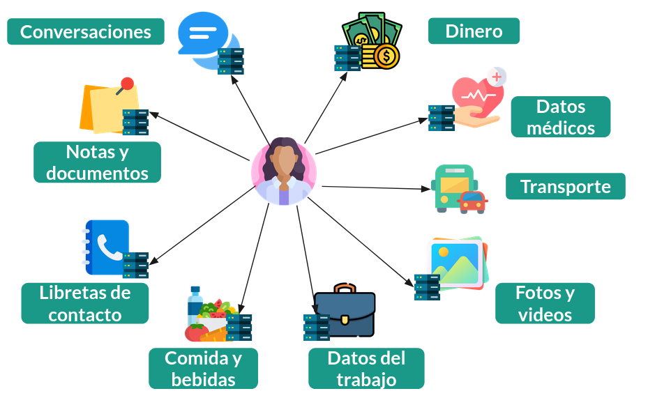
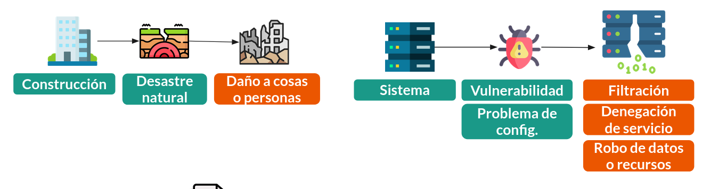
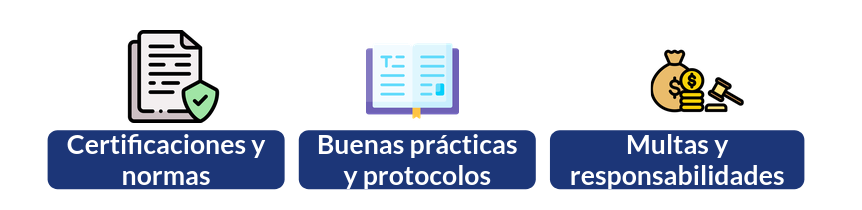

Tal como hemos discutido a lo largo de las secciones anteriores, el software hoy se usa para procesos sumamente críticos en el funcionamiento de la sociedad, lo que requiere preservar la confidencialidad, integridad y disponibilidad de los canales de comunicación y los sistemas que sustentan estos procesos. Algunos de ellos se ven en la imagen a continuación:

Así como en la construcción de edificios un desastre natural no contemplado en su diseño puede generar daños a personas y a cosas, el software tiene sus propios "desastres" (solo que generalmente no son naturales, si no que debido a acción o inacción humana), que generan afectación a personas o procesos.

En ambos casos, lo que suele resultar para mejorar la calidad de lo potencialmente afectado es la creación de normas y certificaciones, la estandarización de protocolos y buenas prácticas y la existencia de multas que desincentiven el no cumplir.

En esta unidad veremos el impacto que tienen las dependencias de código en la seguridad de los sistemas, discutiremos algunas técnicas para desarrollar código disminuyendo la probabilidad de introducir vulnerabilidades y mencionaremos algunas herramientas que permiten encontrar de forma preventiva vulnerabilidades en nuestro código.

