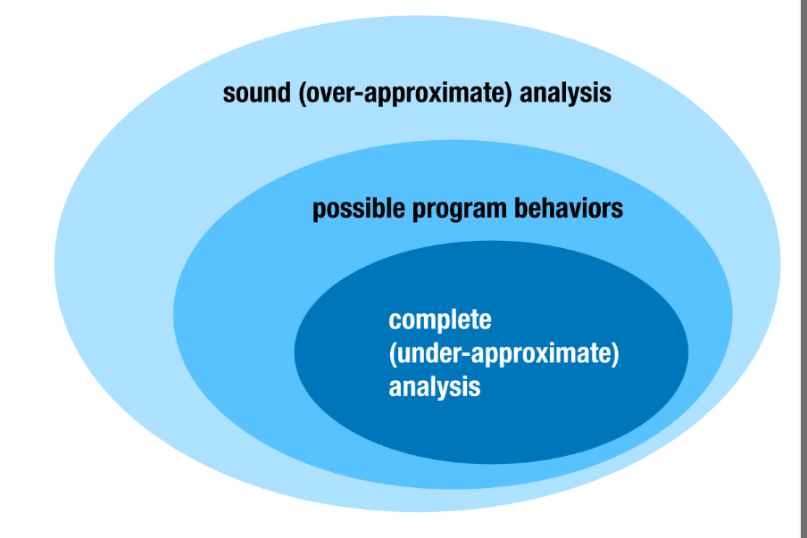
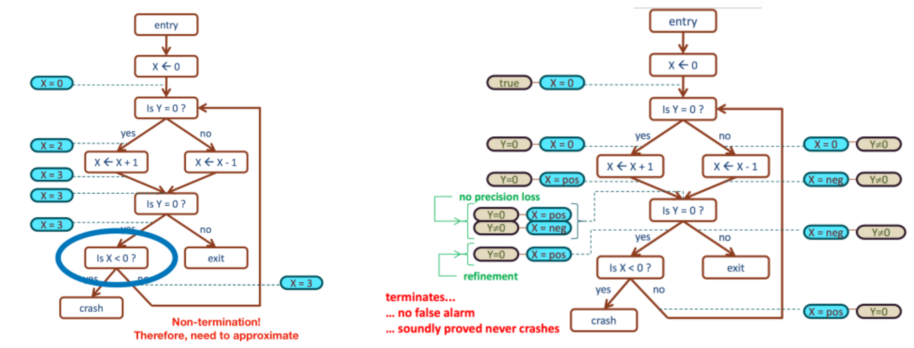
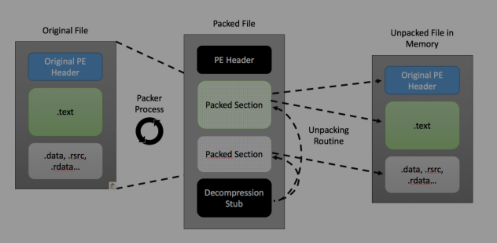

# Análisis Estático, Dinámico y _Tests_ de integración y unitarios

A medida la cantidad de código aumenta en un sistema, las interacciones entre sus componentes se hacen más difíciles de monitorear. Como no es práctico ejecutar todas las acciones posibles en una aplicación antes de ponerla en producción luego de agregar nuevas funcionalidades o corregir bugs, existen técnicas automáticas y semi-automáticas para reducir la probabilidad de contar con comportamiento inesperado o introducir brechas de ciberseguridad. Hablaremos de ellas en este capítulo, así como también de cómo han ido modificándose debido al uso masivo de herramientas de IA generativa. 

* El *análisis estático* considera la revisión de aplicaciones sin necesidad de ejecutarlas. Esto incluye la revisión de código fuente y de binarios (via *ingeniería reversa*) y la elaboración y ejecución de _tests_, todo para encontrar comportamientos y posibles casos de fallo.

* El *análisis dinámico* por su parte permite analizar una aplicación en un entorno de ejecución, monitoreando su uso de memoria, acceso a archivos y comportamiento general.

* Los _tests_ son pedazos de código en los programas que no se usan en su versión funcional, pero sí como parte del proceso de despliegue se las aplicaciones para comprobar automáticamente que se cumplen ciertos invariantes a pesar de agregar nuevas funcionalidades. Si bien su utilidad es más grande que solo encontrar vulnerabilidades o debilidades, se recomienda usarlos tanto para demostrar comportamientos de componentes dentro de un mismo módulo (test unitario) como para validar integraciones entre varios módulos y sistemas (test de integración).

## Análisis Estático

### Dificultades del Análisis Estático

La mayor dificultad al realizar análisis estático es que es imposible crear un _revisor universal_ que valide todo tipo de programas. Esto se desprende del **Teorema de Rice**, el que indica que todas las propiedades no triviales (que sea válida solo para algunos y no para todos los programas) y semánticas (asociadas al _comportamiento_ de un programa) son indecidibles, es decir, no existe un algoritmo que pueda contestar universalmente estas preguntas. Lo más a lo que podemos aspirar es crear herramientas que generen falsos positivos (sobreestime, _sound analysis_ en la imagen) o falsos negativos (subestime, _complete_ en la imagen) lo anterior.

### Algunos tipos de análisis estático

* **Análisis de código fuente**: potenciado fundamentalmente por servidores de lenguajes de programación (LSP), los mismos que ayudan a destacar el código del editor y detectar los argumentos de las funciones llamadas. Esto se puede hacer de alguna de estas formas:
  * **Buscando cadenas inseguras**, como cuando se busca el uso de funciones inseguras con nombres específicos
  * **Encontrando patrones inseguros en el AST**: como cuando se usan argumentos de forma incorrecta, se exponen funciones que no deberían o el código se aleja del estándar de formateo establecido.
  * **Usando herramientas de IA generativa**: Si el modelo es lo suficientemente avanzado y cuenta con contexto suficiente, muchas veces la revisión del código puede encontrar algunas vulnerabilidades de diseño o desarrollo básicas. Esto podría ir cambiando a medida pasen los años, pero siempre con un margen de inexactitud que debiese requerir una interpretación de un humano capaz de comprender el contexto completo del problema a solucionar.

  OWASP [mantiene una lista](https://owasp.org/www-community/Source_Code_Analysis_Tools) de herramientas de análisis estático disponibles

 * **Revisión de modelos y verificación**: Si se ve la especificación de un sistema como una máquina de estados finita y se definen cuales son los estados correctos en este sistema de forma matemática, es posible verificar la ausencia de comportamientos distintos a los especificados, al menos en el modelo. Sin embargo, es importante entender que la **implementación no siempre es lo mismo que la especificación**. Así como un algoritmo criptográfico en papel puede no tener vulnerabilidades importantes conocidas, eso no significa que la implementación realizada por un usuario no introduzca problemas tanto a nivel teórico como desde un punto de vista práctico (filtración de datos por canales laterales, uso de dependencias infectadas o fraudulentas, entre otros)

 Hay un curso sobre este enfoque en la Universidad de Rwthaachen en Alemania. El material está disponible en [esta página](https://moves.rwth-aachen.de/teaching/ss-15/introduction-to-model-checking/).

  * **Análisis aproximado y ejecución simbólica**: En algunos casos, es posible generalizar las distintas ramas que toma una aplicación según los invariantes que se van especificando a lo largo de la ejecución del código. En la imagen siguiente (del curso CS155 de la U. de Stanford) vemos un ejemplo. Si nos ponemos a revisar en una función, para cada valor posible, si esta falla o no, probablemente nos va a costar mucho encontrar un caso mal definido. Si, al contrario, definimos propiedades generalizables, la tarea se simplifica. El mayor problema es que este tipo de análisis crece exponencialmente según la complejidad de la función y el número de variables externas. 

## Análisis Dinámico e Ingeniería Reversa

El análisis dinámico es útil tanto para encontrar bugs como para comprender el funcionamiento de aplicaciones compiladas u ofuscadas. El caso más común de análisis dinámico se representa en los _tests_ ya mencionados, los cuales requieren ejecutar parte del código de la aplicación para probar si se cumplen los supuestos establecidos. 

Otro enfoque útil para encontrar algunos tipos de vulnerabilidades difíciles de detectar es el del _fuzzing_, que consiste en ejecutar la aplicación usando una gran cantidad de entradas generadas aleatoriamente, con más o menos estructura, monitoreando el comportamiento de la aplicación ejecutada frente a ellas. Dentro de fuzzing existen varios modelos, como por ejemplo:
 * **Basado en mutación**, cuando se agregan anomalías aleatorias a entradas válidas (ejemplo, dar vuelta bits o bytes del software aleatoriamente, colocar datos inconsistentes, entregar más o menos información que la prometida, etc)
 * **Generativo**: A partir de la estructura de la entrada (conocida por la persona que hace las pruebas), crear un programa (o solicitar a una IA generativa) que mantenga la estructura pero varíe algunos campos por valores poco comunes.
 * **Evolucionario**: Dependiendo de las respuestas obtenidas del programa ejecutado, se puede ir modificando la entrada. 

Fuzzing como técnica es relativamente nueva, y cuando se "descubrió" o hizo de moda generó una ola de muchas vulnerabilidades de manejo de memoria, las cuales fueron parchadas en su momento. En [esta presentación](https://www.youtube.com/watch?v=lK5fgCvS2N4) cuentan un problema de fuzzing en una aplicación de PDF del año 2010. El 2014 también experimentaron algunos generando JPEGs a partir de las respuestas de una aplicación para verlos, como se ve en [este artículo](https://lcamtuf.blogspot.com/2014/11/pulling-jpegs-out-of-thin-air.html).

> [!COMMENT]
> Ese último ya no suena tan _wooow_, existiendo tan masivamente sitios que crean imágenes del aire millones de veces más completas y definidas 😥

## Ingeniería reversa como riesgo (u oportunidad)

Como vimos en módulos anteriores, el código que uno ejecuta en su computador debe ser entendible por su computador, por lo que, mientras mantengamos cierto control sobre el comportamiento de nuestros dispositivos, es muy difícil que no exista forma alguna de que podamos entender qué hace un programa ejecutable en nuestros equipos, por mucho que el equipo de desarrollo haya intentado hacer esto lo más difícil posible.

De un binario podemos aprender de:
* **Funcionalidades ocultas o no ejecutables de forma tradicional**: Si quedó en la compilación del código, está al alcance del usuario que cuenta con el binario
* **Contraseñas y llaves**: ¡Nunca agregar un valor secreto en un binario! Principio de Kerchoff: la llave secreta debe estar fuera del mecanismo o pierde el sentido.
* **Comentarios**: Si el código mantiene strings de debug o no fue minificado, esto puede ayudar a un externo a entenderlo mejor.
* **Infraestructura oculta**: Servidores u otros elementos que están incrustados en el binario pueden ser descubiertos y llamados directamente por el usuario o usuaria.

Para evitar lo anterior, algunas personas usan técnicas (generalmente de ofuscación) que dificultan al atacante (en el modelo de amenaza del fabricante) obtener información útil:

* A veces se encripta el código o las variables del binario. Esto puede ser revertido si se encuentran las llaves de cifrado desde la misma ubicación que el sistema operativo las saca al ejecutar el programa.
* Existe software de _packing_, que (como se muestra en la imagen) desordena y reordena el contenido del código de una aplicación para dificultar su análisis.
* Algunos tipos de software (especialmente el malicioso) detectan cuando uno los está corriendo en un entorno de laboratorio y se autodestruyen. esta imagen muestra lo anterior:

  

Algunas herramientas para hacer ingeniería reversa (dejando de lado el uso de IA generativa que puede ayudar en todos los casos siguientes, e incluso algunos más): 
  * **En Web**: Uso de consola de desarrollador o de plugins o frameworks que intercepten consultas. 
  * **Escritorio/Servidores** Aplicaciones como IDA, Binary Ninja, OllyDbg, Ghidra (de la NSA estadounidense) o Radare2 sirven para pasar el asm de un binario a algo más parecido a código fuente.
  * **Móviles**: Herramientas como Objection y Frida sirven para monitorear el comportamiento de una aplicación web con un móvil y hacer cambios dinámicamente si es necesario.

De la misma manera, existen mecanismos para dificultar la deobfuscación:
 * **En web**, Uglifiers de JS y el ejemplo mostrado en el primer comentario de abajo.
 * **Escritorio/Servidores**: usar herramientas de packing como UPX.
 * **En Móvil**: Android tiene librerías internas (como ProGuard) que cambian la estructura entendible de las aplicaciones por letras y números prácticamente aleatorios, manteniendo funcionalidad pero dificultando el trabajo. También hay librerías para frameworks como React (_react-native-obfuscating-transformer
_) que ofuscan el código.

> [!COMMENT]
> ¿No quieres que alguien haga reversing de tu código Javascript con IA generativa? Puedes hacerle creer a un modelo de lenguaje que tu código javascript fue creado para portarse muy, muy mal, como esta empresa de fingerprinting descubierta por [este internauta](https://nullpt.rs/fingerprinting-bioweapons). Hablaremos más de fingerprinting en _privacidad_.

> [!COMMENT]
> Tal vez la ingeniería reversa es una de las áreas en las que el impacto negativo de un mal resultado de una IA generativa es el menor. El objetivo para un investigador o atacante es intentar generar un modelo mental de funcionamiento de la aplicación qeu está analizando. Por mucho que _chamulle_ una IA, la persona que hace el análisis debería tener la capacidad de ponderar estos comentarios y definir su inclusión o no.

## Herramientas de ciberseguridad basadas en IA

* **Claude Mythos y OpenAI Codex**: Al menos desde fines de 2025, las herramientas de IA generativa orientadas a encontrar vulnerabilidades han generado un aumento importante en la cantidad de CVEs encontrados. Ellas usan un enfoque de revisión híbrido: En muchos casos revisan el código completo y entregan un resultado similar (aunque con efectividad variable) al que entregaría un pentester. En otros casos intentan ejecutar ataques sobre una instancia corriendo de un sistema. Uno podría interpretarlos como un comportamiento muy parecido al _fuzzing_, pero mucho mas potente y estructurado.
* **Sistemas de Pentesting autónomos, como ARTEX**: [ARTEX](https://github.com/lenaxia/artex) es un sistema de pentesting autónomo que ha aparecido mencionado en varios ciberataques durante la segunda mitad de 2026, bajando la vara de experiencia necesaria para ejecutarlos.

## Recomendaciones

* Contar con mecanismos de análisis automático en el proceso de desarrollo continuo del software
* Mantener continuamente el desarrollo de tests, asegurándose que los tests representen fielmente el comportamiento esperado de la aplicación.
* (si está la posibilidad), intentar realizar al menos un escaneo periódico a las aplicaciones expuestas con una herramienta de IA generativa (si uno no lo hace, puede hacerlo un atacante y encontrar cosas que nosotros no hemos encontrado todavía).