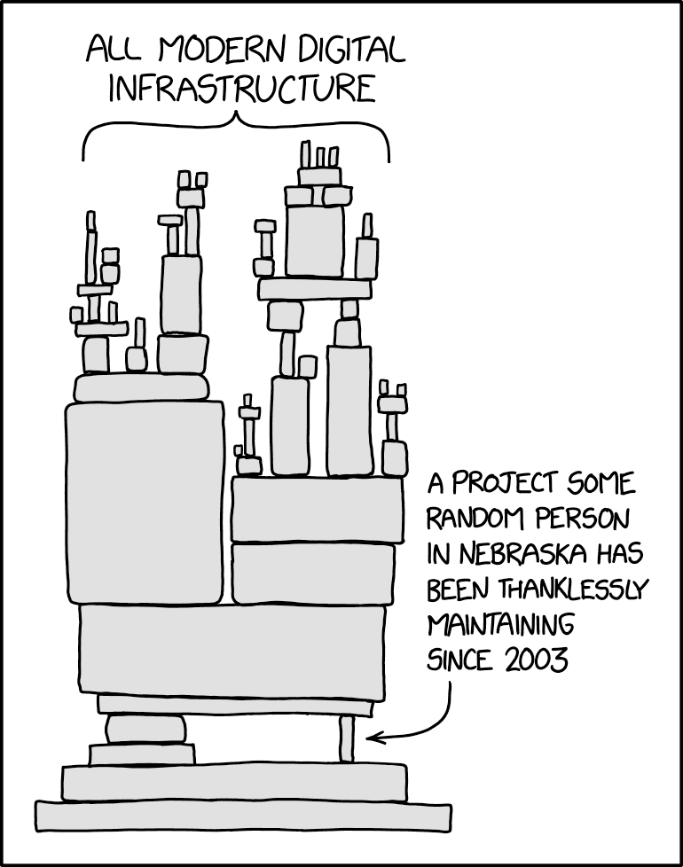

# Dependencias y Ataques de Cadena de Suministro

Para desarrollar software, hoy dependemos siempre de software desarrollado por alguien más. Descartando los casos más obvios (cuando usas un lenguaje de programación, estás usando software de otra persona), esto también ocurre en las siguientes situaciones:

* Cuando desarrollas para un sistema operativo específico, puede que uses frameworks del fabricante del OS o librerías de terceros que resuelvan problemas complejos y específicos como criptografía, procesamiento de multimedia, interfaces gráficas y argumentos en utilidades de terminal.
* Cuando desarrollas aplicaciones web, puede que uses librerías (internas o de terceras personas) para hacerse cargo de las conexiones HTTP o WebSockets, de las sesiones, del almacenamiento de archivos, del manejo de la base de datos, de medidas de seguridad (como Rate Limit, Anti-CSRF...), entre otros.
* En tu proceso de despliegue o integración continua, puede que ejecutes código hecho por otras personas para correr tests, levantar un entorno de prueba adecuado, ejecutar pruebas de seguridad automáticas, subir código al entorno correspondiente, entre otros.

A todos estos componentes se les suele llamar _dependencias_ de un software. 

Es bastante común depender de software de otros, al menos por los siguientes motivos:

* Permite delegar la implementación de componentes complejos a expertos/as (como librerías criptográficas). Usando dependencias, la persona que desarrolla no necesita conocer al 100% el contenido de estos componentes, pero es necesario confiar en el proveedor

> [!COMMENT]
> Curioso pensar hoy en lo fácil que era hasta hace unos años confiar antes en código abierto en GitHub y simplemente correrlo para resolver un problema. El aumento de incidentes relacionados con estas 

Puede que como usuario/a confíes mucho en el proveedor de tu herramienta, pero probablemente no tienes idea de qué otras herramientas depende la aplicación que estás usando, y si los equipos de desarrollo de esas dependencias son tan o más seguros que lo que es tu proveedor directo.

> [!COMMENT]
> A veces pasa incluso (y ahora con esto de la IA generativa pasa mucho más) que el equipo de desarrollo no sabe qué dependencias usa en su software 😔

Muchos atacantes se aprovechan del "eslabón más débil" para poder ingresar a infraestructura crítica o a proveedores más importantes, por lo que es de *suma importancia* conocer los alcances de este tipo de ataques para evitar 

## Cómo funciona un ataque de cadena de suministro

En general, cuando el actor malicioso es externo al equipo de desarrollo del software, un ataque de cadena de suministro funciona así:

* **Atacante elige una víctima**: El atacante define una víctima específica.
* **Atacante estudia dependencias de software usado por víctima**: Atacante estima qué software podría estar usando su objetivo. Si el producto de la institución definida como futura víctima es de código abierto, el atacante tiene mucha más facilidad para determinar la lista de software potencialmente afectable
* **Atacante busca vulnerabilidad en software del cual depende, o intenta atacar directamente a sus trabajadores**: En el primer caso, se busca una vulnerabilidad que pueda ser explotada desde el software de la institución víctima para escalar privilegios o conseguir otros accesos. En el segundo caso, el atacante ejecuta campañas fraudulentas para intentar conseguir alguna credencial administrativa de su víctima.
* **Atacante accede al sistema de la dependencia y modifica el código de la dependencia**. El atacante modifica el código fuente de la dependencia de la cual se consiguieron permisos administrativos. Este código podría incluir un backdoor que se ejecuta siempre o en condiciones muy específicas, para evitar que otras personas lo detecten antes de tiempo.
* **Víctima actualiza su dependencia con el código malicioso y es infectada**

## Casos conocidos

Estos son algunos casos conocidos en los que se comprometieron (tanto por el fabricante como por actores externos) dependencias de otro software, generando problemas en integridad, disponibilidad o confidencialidad debido a ello:

* **NPM y `left-pad`**: El 22 de marzo de 2016, el mantenedor del paquete de NPM `left-pad` (que ayudaba a calcular cuántos espacios eran necesarios para alinear una cadena de texto a la derecha usando una tiografía monotipo), Azer Koçulu, lo eliminó del repositorio porque Npm Inc. le quitó el nombre del paquete `kik` para pasárselo a una empresa del mismo nombre. Esto provocó que un montón de proyectos que dependían de `left-pad` dejaran de ser compilables. Hoy, NPM no permite el borrado de los paquetes más populares.

  Este no es el único caso de ejemplo de problemas ocurridos en NPM y otros repositorios de dependencias. El 7 de marzo de 2022, Brandon Nozaki agregó la dependencia `peacenotwar` al paquete `node-ipc`. El código sobreescribe todos los bytes de los archivos de usuario del sistema por el emoji ♥️, si el usuario se conectaba desde una IP rusa o bielorrusa.

* **SolarWinds**: SolarWinds es una empresa relacionada con herramientas para el desarrollo y monitoreo de software, fue víctima de un ciberataque el 2019 en el que el atacante publicó una actualización maliciosa de sus aplicaciones, la cual fue instalada al menos por 18 mil clientes. Los atacantes consiguieron meses antes de la publicación del binario malicioso acceso a la red interna de la empresa, agregando código a la aplicación de usuario final sin que nadie se diese cuenta. La empresa Fortinet explica brevemente el caso [en esta plataforma](https://www.fortinet.com/resources/cyberglossary/solarwinds-cyber-attack).

* **`xz utils backdoor`**: `xz` es una utilidad de código abierto usada para comprimir archivos tanto de forma directa como siendo una dependencia de otras aplicaciones en Linux. En marzo de 2024 (meses antes del lanzamiento de Ubuntu 24.04 LTS), un empleado de Microsoft (Andres Freund) notó que su computador con Debian Sid (la versión inestable con los últimos cambios disponibles) se había vuelto más lento de un día para otro. Al reportar esto a Debian, se descubrió que el ataque había partido en 2021, cuando un usuario de GitHub inició una campaña para que la persona encargada de mantener la librería le diera permisos de mantenedor. [En esta charla de casi 2 horas](https://www.youtube.com/watch?v=jg5F9UupL6I&t=1584s&themeRefresh=1) se explica en detalle el proceso de descubrimiento del ataque.

* **Trivit y LiteLLM**: En marzo de 2026, el grupo de desarrollo de LiteLLM (herramienta que funciona como proxy para conectarse con múltiples provedores de APIs de modelos de IA Generativa) [advirtió](https://docs.litellm.ai/blog/security-update-march-2026) que fueron víctimas de un potencial ataque de cadena de suministro. Un atacante logró publicar 2 versiones del paquete de Python `litellm`, a través de obtener las credenciales de los mantenedores de LiteLLM ya que ellos usaban una librería de análisis automático de dependencias en contenedores llamada Trivit, herramienta que fue vulnerada en primera instancia por los atacantes. En agosto de 2026, varios investigadores encontraron evidencia de que el malware en LiteLLM había logrado acceder a un montón de variables de entorno de despliegue de software de más de 2500 compañías. Puedes encontrar la lista de potenciales afectados [en este sitio.](https://www.cloudsek.com/blog/ai-supply-chain-breach-2500-companies-434000-cicd-pipelines)

* **PHP2Shell**: Unos días antes del 20 de octubre de 2026, corría el rumor en círculos de desarrolladores de que se habían encontrado vulnerabilidades sumamente críticas en PHP con ayuda de modelos de IA generativa, las que permitirían ejecución de código remoto. Las vulnerabilidades ([CVE-2026-109618 y CVE-2026-109619](https://www.php2shell.com/) ) eran difíciles de explotar y dependían de varios factores del entorno de despliegue de las aplicaciones, se encontraron casos de laboratorio (y otros no tanto) en los que se logró usar un exploit de forma exitosa. El proceso de gestión de estas vulnerabilidades demostró el impacto que tiene encontrar problemas de seguridad en bases de código ampliamente usadas (se dice que PHP potencia casi el 70% de los sitios web del mundo). Se cree que, al igual que como pasó con Log4J (librería de logging de java a la que se le encontró [una vulnerabilidad crítica](https://es.slideshare.net/slideshow/cve202144228-log4j-and-log4shell-executive-explainer-by-cjebugcrowd/250835058) a fines de 2021), pasarán años hasta que la cantida de servidores vulnerables expuestos a Internet sea tan pequeña como para no generar preocupación.

 > [!COMMENT]
 > En los círculos de administradores de sistemas y expertos de seguridad informática, la semana de publicación de la vulnerabilidad de PHP fue agotadora. Aparte de PHP, se encontraron vulnerabilidades en software de amplio uso como GitLab y Node. [Algunas personas](https://lobste.rs/s/xgih2x/i_want_my_wednesday_back), eso sí, argumentan que si bien las vulnerabilidades eran críticas, la dificultad de explotación hizo que la reacción en su parchado fuera algo desproporcionada y contraproducente.

## ¿Debemos dejar de depender de software? 

[XKCD Obligatorio (2347)](https://xkcd.com/2347/)

Hay algunas personas que consideran que con el advenimiento de técnicas de desarrollo mediante IA Generativa, ya no es necesario contar con dependencias de código de otros desarrolladores, lo que nos ahorra la preocupación de seguridad por ese lado. Si bien puede que este enfoque sea útil para algunos alcances, deja de considerar, al menos, las siguientes:

- El código puede no haber ha sido validado por nadie antes de ejecutarlo.
- El código puede tener vulnerabilidades no revisables por un humano del equipo
- El código puede funcionar incorrectamente, ya que la persona que pidió desarrollarlo no entiende los requisitos reales del módulo.
- Incluso si consideramos que es buena idea depender solo de código generado por IA, casi seguramente ese código generado está basado en código previamente creado por otras personas, por lo que al final sí existe una dependencia externa, solo que mucho más difícil de mapear.

Es por lo anterior que es discutible pensar que será posible en el corto plazo dejar de depender de librerías especializadas en algunos contextos complejos, como aplicaciones web, criptografía o software diseñado para resolver problemas específicos pero que impactan a muchas personas.

## Mitigaciones

Todo el software depende tanto de otro software que es un problema muy difícil de mitigar por completo. Algunas recomendaciones para evitar ser víctima de este tipo de ataques son:

* **Usar solo dependencias confiables**: Usar dependencias solo mientras se consideren confiables de parte del equipo de desarrollo. Si se observa que la dependencia "cambia de manos" o es abandonada por mucho tiempo, buscar alternativas o desarrollar el componente internamente si existe el conocimiento y las capacidades para ello.

* **_Package version locking_**: Puede sonar un poco contraintuitivo, pero en los casos en los que existe un alto riesgo de inyección de malware en una librería externa, puede convenir no actualizar a las últimas versiones automáticamente, en algunos casos por compatibilidad pero también por seguridad. 

  El supuesto es que si un atacante modifica una librería para volverla maliciosa con un acceso administrativo al pipeline de despliegue y uno actualiza automáticamente, uno debería tener la posibilidad de chequear si el paquete y sus cambios siguen sirviendo para el propósito original.

  Para ello, muchos gestores de paquetes hoy tienen un archivo (`package.lock` o nombre similar) que permite registrar la versión y el hash del paquete en el sistema.

* **Usar herramientas de monitoreo para detectar comportamientos anómalos en tiempo real**: Veremos esto con más detalle en la unidad de monitoreo y prevención, pero básicamente consiste en establecer alertas que detecten comportamientos extraños (conexiones a sitios inesperados, descargas o subidas masivas de información) en sus sistemas.

* **Software Bill of Materials (SBOM)**: Si no sé de qué dependo, no puedo elaborar un modelo de amenaza realista en el que pueda enterarme de qué vulnerabilidades conocidas me afectan. El objetivo de este estándar (descrito en [el sitio de la Agencia de Ciberseguridad e Infraestructura estadounidense](https://www.cisa.gov/topics/information-communications-technology-supply-chain-security/sbom)) es llevar un inventario de productos y versiones de software usados como dependencias de sistemas internos, de modo de poder monitorear automáticamente cuando aparecen vulnerabilidades para alguno de estos componentes.
  * Puedes llevar uno de estos inventarios con software libre como [Dependency Track](https://dependencytrack.org/) del Proyecto OWASP.
  * Hay herramientas para Forges de código (como GitHub y Forgejo) que permiten monitorear dependencias obsoletas, como Dependabot (nativo en GitHub) y [Renovate](https://docs.renovatebot.com/).

